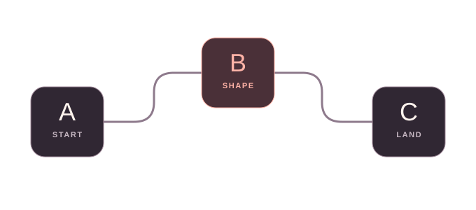

<!-- _class: invert ml ml-cover -->
<!-- _paginate: skip -->
<!-- _transition: cover 600ms -->

MOTION LAB AN EXPERIMENT IN PRESENTATION DESIGN

# Same diagram. Different verbs.

From CSS and SVG to frames, film, and vectors. Change the technique, not the subject.

  
THE SPECIMEN3 NODES / 1 RELATIONSHIP

  

    <svg class="ml-rails" viewBox="0 0 680 300" aria-hidden="true"><path class="ml-rail" d="M96 174 H192 Q220 174 220 146 V132 Q220 104 248 104 H432 Q460 104 460 132 V146 Q460 174 488 174 H584"/></svg>
    
<b>A</b>START

    
<b>B</b>SHAPE

    
<b>C</b>LAND

  

NINE TECHNIQUES. ONE SPECIMEN. Arrow keys navigate. Play once starts each experiment. Next cut: Marp cover.

<!--
This is a lab about animation techniques, not a simulation of another engineering
system. A, B, and C are an intentionally neutral specimen: start, shape, land.
The same positions, dimensions, connecting path, and labels recur in the next eight
experiments. Only the motion mechanism changes. The morph pair then changes layout
while keeping the identities. Every slide is understandable as a still.
Animations start manually, run once, and can be paused or replayed in the audience
window. CSS and native SVG interpolate the first examples. Frames and video are
pre-rendered, and Lottie requires a locally packaged JavaScript vector renderer.
Shared JavaScript manages playback, slide activation, and accessibility; Marp itself
also uses JavaScript. None of these examples claim "no JavaScript anywhere."
The opening boundary visibly demonstrates Marp's built-in cover transition.
-->

---

<!-- _class: invert ml -->

01 / SEQUENCE CSS KEYFRAME CHOREOGRAPHY

## Give the eye an order.

A leads. B answers. C lands. The diagram never changes its meaning.

  

    
THE SAME SPECIMENCSS / 4 SECONDS

    

      <svg class="ml-rails" viewBox="0 0 680 300" aria-hidden="true"><path class="ml-rail" d="M96 174 H192 Q220 174 220 146 V132 Q220 104 248 104 H432 Q460 104 460 132 V146 Q460 174 488 174 H584"/></svg>
      
<b>A</b>START

      
<b>B</b>SHAPE

      
<b>C</b>LAND

    

    
<button type="button" data-motion-action="toggle">Play once</button><button type="button" data-motion-action="replay">Replay</button>Ready / plays once

    
STILL FRAME / A connects to B, then C. Motion adds emphasis, not information.

  

  <aside class="ml-mechanism">
    
THE MECHANISM

    <h3>Keyframes + delays.</h3>
    
One gesture, staggered across three objects.

    <pre><code>animation: lift 2s both;
animation-delay: 1s;</code></pre>
    
<b>Use for</b> order and emphasis. <b>Watch for</b> too many entrances.

  </aside>

Choreography changes <strong>when attention arrives.</strong>

<!--
The three HTML node cards share the ml-lift CSS keyframes, delayed by 0, 1, and
2 seconds. Each gesture lasts 2 seconds, so the whole sequence ends at 4 seconds.
Only transform and box-shadow change; labels and the connecting path stay visible.
The JavaScript toggles CSS playback classes. CSS, not JavaScript, interpolates the
frames. Pause sets animation-play-state; Replay removes and restarts the keyframes.
Source: https://developer.mozilla.org/en-US/docs/Web/CSS/CSS_animations/Using_CSS_animations
-->

---

<!-- _class: invert ml -->

02 / TRACE SVG STROKE DRAWING / TIMED BY CSS

## Draw the relationship.

Keep the nodes still. Let the connection become the sentence.

  

    
THE SAME SPECIMENSVG + CSS / 4 SECONDS

    

      <svg class="ml-rails" viewBox="0 0 680 300" aria-hidden="true">
        <path class="ml-rail" d="M96 174 H192 Q220 174 220 146 V132 Q220 104 248 104 H432 Q460 104 460 132 V146 Q460 174 488 174 H584"/>
        <path class="ml-ink ml-drawn-route" pathLength="1" data-ml-animate d="M96 174 H192 Q220 174 220 146 V132 Q220 104 248 104 H432 Q460 104 460 132 V146 Q460 174 488 174 H584"/>
      </svg>
      
<b>A</b>START

      
<b>B</b>SHAPE

      
<b>C</b>LAND

    

    
<button type="button" data-motion-action="toggle">Play once</button><button type="button" data-motion-action="replay">Replay</button>Ready / plays once

    
STILL FRAME / A connects to B, then C. Motion adds emphasis, not information.

  

  <aside class="ml-mechanism">
    
THE MECHANISM

    <h3>A dash becomes a line.</h3>
    
Normalize the path length to 1. Animate its dash offset to 0.

    <pre><code>stroke-dasharray: 1;
/* offset: 1 to 0 */</code></pre>
    
<b>Use for</b> a connection or outline. <b>Watch for</b> complex path order.

  </aside>

Stroke drawing changes <strong>how a connection is discovered.</strong>

<!--
The SVG path has pathLength="1". CSS sets stroke-dasharray: 1 and animates
stroke-dashoffset from 1 to 0 over four seconds. This is SVG geometry with a CSS
animation, not SMIL and not a JavaScript path-length calculation.
A muted full route remains underneath, including in the starting frame. The static
and print states show the entire colored route. Pausing freezes the drawn length.
Source: https://developer.mozilla.org/en-US/docs/Web/SVG/Reference/Attribute/pathLength
Source: https://developer.mozilla.org/en-US/docs/Web/CSS/stroke-dashoffset
-->

---

<!-- _class: invert ml -->

03 / TRAVEL DECLARATIVE SVG / ANIMATEMOTION

## Move something. Not everything.

A single signal follows the same route. The browser handles the geometry.

  

    
THE SAME SPECIMENNATIVE SVG / 4 SECONDS

    

      <svg class="ml-rails ml-motion-svg" viewBox="0 0 680 300" aria-hidden="true">
        <path class="ml-rail" d="M96 174 H192 Q220 174 220 146 V132 Q220 104 248 104 H432 Q460 104 460 132 V146 Q460 174 488 174 H584"/>
        <circle class="ml-rest-signal" cx="504" cy="174" r="8"/>
        <circle id="ml-route-signal" class="ml-packet" r="8"/>
        <animateMotion href="#ml-route-signal" begin="indefinite" dur="4s" repeatCount="1" fill="freeze" calcMode="paced" path="M148 174 H192 Q220 174 220 146 V132 Q220 104 248 104 H432 Q460 104 460 132 V146 Q460 174 488 174 H528"/>
      </svg>
      
<b>A</b>START

      
<b>B</b>SHAPE

      
<b>C</b>LAND

    

    
<button type="button" data-motion-action="toggle">Play once</button><button type="button" data-motion-action="replay">Replay</button>Ready / plays once

    
STILL FRAME / A connects to B, then C. Motion adds emphasis, not information.

  

  <aside class="ml-mechanism">
    
THE MECHANISM

    <h3>The path is the timeline.</h3>
    
<code>animateMotion</code> moves the signal at a paced speed.

    <pre><code>&lt;animateMotion
  path="M148 174 ..."
  dur="4s" /&gt;</code></pre>
    
<b>Use for</b> travel along a route. <b>Watch for</b> SVG clock control.

  </aside>

Path motion changes <strong>where attention is carried.</strong>

<!--
The signal is a native SVG animateMotion element (SMIL). begin="indefinite" stops
it from running on every hidden slide when the document opens. beginElement starts
it; pauseAnimations and unpauseAnimations control the SVG clock. JavaScript never
computes positions. The signal follows the visible route between the outer cards,
passing behind B, and repeatCount="1" makes it finite.
The sibling animation uses an explicit href target; this also avoids HTML
normalization treating a nested SVG circle as an empty element during export.
CSS animation-play-state does not pause SMIL: it needs its own SVG clock methods.
Print, no-JS, reduced-motion, and presenter views hide the moving signal and show
a separate authored static marker. Changing browser motion preferences resets it.
Source: https://developer.mozilla.org/en-US/docs/Web/SVG/Reference/Element/animateMotion
Source: https://developer.mozilla.org/en-US/docs/Web/API/SVGSVGElement/pauseAnimations
-->

---

<!-- _class: invert ml -->
<!-- _transition: ml-aperture 700ms -->

04 / REVEAL CSS MASK / SOFT-EDGE WIPE

## Reveal ink, not new structure.

A moving aperture exposes the highlight. Nothing underneath changes position.

  

    
THE SAME SPECIMENCSS MASK / 4 SECONDS

    

      <svg class="ml-rails" viewBox="0 0 680 300" aria-hidden="true"><path class="ml-rail" d="M96 174 H192 Q220 174 220 146 V132 Q220 104 248 104 H432 Q460 104 460 132 V146 Q460 174 488 174 H584"/></svg>
      
<b>A</b>START

      
<b>B</b>SHAPE

      
<b>C</b>LAND

      <svg class="ml-rails ml-mask-ink" data-ml-animate viewBox="0 0 680 300" aria-hidden="true">
        <path class="ml-ink" d="M148 174 H192 Q220 174 220 146 V132 Q220 104 248 104 H288 M392 104 H432 Q460 104 460 132 V146 Q460 174 488 174 H532"/>
        <g class="ml-ink"><rect x="44" y="124" width="104" height="100" rx="20"/><rect x="288" y="54" width="104" height="100" rx="20"/><rect x="532" y="124" width="104" height="100" rx="20"/></g>
      </svg>
    

    
<button type="button" data-motion-action="toggle">Play once</button><button type="button" data-motion-action="replay">Replay</button>Ready / plays once

    
STILL FRAME / A connects to B, then C. Motion adds emphasis, not information.

  

  <aside class="ml-mechanism">
    
THE MECHANISM

    <h3>Move the aperture.</h3>
    
A gradient mask controls alpha. Shift the mask, not the nodes.

    <pre><code>mask-image:
  linear-gradient(...);
/* position: 100% to 0 */</code></pre>
    
<b>Use for</b> a reveal or spotlight. <b>Watch for</b> hidden labels.

  </aside>

A mask changes <strong>what is visible through a window.</strong>

NEXT CUT / A custom Marp clip-path aperture opens the next slide.

<!--
The overlay SVG contains only colored connector segments and card outlines.
Its CSS alpha mask is a wide black-to-transparent linear gradient. Animating
mask-position from 100% to 0% exposes the overlay left-to-right; a soft gradient
edge distinguishes this mask from a hard clip-path wipe.
The underlying diagram, especially the labels, stays complete and stationary.
At rest, in print, and without JavaScript the mask is removed, showing all ink.
Masks can add painting/compositing work; do not assume every effect is GPU-only.
The next slide boundary is a separate custom Marp transition, ml-aperture. Its
clip-path keyframes create a hard-edged opening across the complete slide.
Source: https://developer.mozilla.org/en-US/docs/Web/CSS/mask-image
Source: https://developer.mozilla.org/en-US/docs/Web/CSS/mask-position
-->

---

<!-- _class: invert ml -->

05 / TILT CSS 3D TRANSFORMS

## Give a flat diagram depth.

Tilt the plane. Lift B toward the viewer. Return to a readable, flat frame.

  

    
THE SAME SPECIMENCSS 3D / 4 SECONDS

    

      

        <svg class="ml-rails" viewBox="0 0 680 300" aria-hidden="true"><path class="ml-rail" d="M96 174 H192 Q220 174 220 146 V132 Q220 104 248 104 H432 Q460 104 460 132 V146 Q460 174 488 174 H584"/></svg>
        
<b>A</b>START

        
<b>B</b>SHAPE

        
<b>C</b>LAND

      

    

    
<button type="button" data-motion-action="toggle">Play once</button><button type="button" data-motion-action="replay">Replay</button>Ready / plays once

    
STILL FRAME / A connects to B, then C. Motion adds emphasis, not information.

  

  <aside class="ml-mechanism">
    
THE MECHANISM

    <h3>A plane and a z-axis.</h3>
    
Perspective on the parent. Preserve depth on the plane.

    <pre><code>perspective: 850px;
transform-style:
  preserve-3d;</code></pre>
    
<b>Use for</b> layers or hierarchy. <b>Watch for</b> distorted text.

  </aside>

Perspective changes <strong>what feels closer.</strong>

<!--
This is CSS 3D, not WebGL. An HTML parent supplies perspective; the diagram plane
uses transform-style: preserve-3d. CSS rotates the plane around X/Y and translates
B along Z. All frames come from CSS keyframes, with a finite four-second duration.
Overflow, filters, opacity, and other grouping properties on a preserve-3d parent
can flatten descendants. The plane avoids them. The surrounding slide still has
Marp's SVG/foreignObject wrapper; verify the actual export, not just a plain div.
The final, print, reduced-motion, no-JS and presenter states are flat and readable.
Source: https://developer.mozilla.org/en-US/docs/Web/CSS/transform-style
Source: https://developer.mozilla.org/en-US/docs/Web/CSS/perspective
-->

---

<!-- _class: invert ml -->

06 / FLIP THROUGH FRAMES SPRITE SHEET / CSS STEPS

## Twelve stills become a gesture.

The same specimen, baked into a strip of images. No shape is interpolated live.

  

    
THE SAME SPECIMEN12 FRAMES / 4 SECONDS

    

      
      

    

    
<button type="button" data-motion-action="toggle">Play once</button><button type="button" data-motion-action="replay">Replay</button>Ready / plays once

    
STILL FRAME / A connects to B, then C. Motion adds emphasis, not information.

  

  <aside class="ml-mechanism">
    
THE MECHANISM

    <h3>Move the filmstrip.</h3>
    
CSS jumps between twelve fixed image cells.

    <pre><code>animation: frames 4s
  steps(11, end) both;
/* 12 cells, 11 jumps */</code></pre>
    
<b>Use for</b> an authored frame style. <b>Watch for</b> size and resolution.

  </aside>

Frame animation changes <strong>which still is on screen.</strong>

<!--
This is a real PNG sprite sheet: twelve 680 by 300 cells laid out horizontally.
CSS background-position advances from 0 to -7480px with steps(11, end), preserving
the first and last cells. There is no smoothing or JavaScript frame selection.
The deliberately low frame count makes the stepped character visible. The next
slide uses the same authored gesture in a pre-rendered 30 fps clip.
Original artwork and source: assets/motion-lab/specimen.svg. Regenerate the sprite,
video, and authored Lottie data with npm run motion:assets. No stock media is used.
Source: https://developer.mozilla.org/en-US/docs/Web/CSS/easing-function/steps
-->

---

<!-- _class: invert ml -->

07 / PLAY THE RENDER LOCAL VIDEO / MOTION GRAPHICS

## Same gesture. Baked pixels.

The motion was rendered before the talk. The browser only decodes the clip.

  

    
THE SAME SPECIMENLOCAL VP9 WEBM / ABOUT 4 SECONDS

    

      
      <video class="ml-film ml-media-live" src="assets/motion-lab/specimen.webm" poster="assets/motion-lab/specimen.svg" preload="none" muted playsinline aria-hidden="true"></video>
    

    
<button type="button" data-motion-action="toggle">Play once</button><button type="button" data-motion-action="replay">Replay</button>Ready / plays once

    
STILL FRAME / A connects to B, then C. Motion adds emphasis, not information.

  

  <aside class="ml-mechanism">
    
THE MECHANISM

    <h3>Render once. Decode later.</h3>
    
One local, silent video. No network service or live rendering.

    <pre><code>&lt;video playsinline
  src="specimen.webm"
  poster="specimen.svg"&gt;</code></pre>
    
<b>Use for</b> a finished motion piece. <b>Watch for</b> codecs and file size.

  </aside>

Video changes <strong>who does the rendering, and when.</strong>

<!--
The repository contains a real, original VP9 WebM clip, recorded offline at 30 fps
from the specimen SVG with Chromium's Canvas/MediaRecorder APIs. Its frame gesture
matches the sprite example, but it contains many more encoded frames.
No animation loop renders this slide live: HTMLMediaElement decodes the local file.
Playback uses the common buttons and media play/pause/currentTime/ended APIs.
There is no audio; the accessible description and static poster describe the full
content, so there is no missing spoken information or caption track.
VP9 WebM is verified in Chromium. Codec support and decoding can vary; the poster
remains available and a decode/load failure is explicitly reported.
Source: https://developer.mozilla.org/en-US/docs/Web/HTML/Reference/Elements/video
-->

---

<!-- _class: invert ml -->
<!-- _transition: slide 600ms -->

08 / PLAY AUTHORED VECTORS LOTTIE / LOCAL JAVASCRIPT RENDERER

## Ship keyframes, not pixels.

The same motif is authored as vector layers. A player renders the in-between frames.

  

    
THE SAME SPECIMENLOTTIE JSON + SVG PLAYER / 4 SECONDS

    

      
      

    

    
<button type="button" data-motion-action="toggle">Play once</button><button type="button" data-motion-action="replay">Replay</button>Ready / plays once

    
STILL FRAME / A connects to B, then C. Motion adds emphasis, not information.

  

  <aside class="ml-mechanism">
    
THE MECHANISM

    <h3>An authoring format + player.</h3>
    
JSON stores shapes and keyframes. Lottie renders scalable SVG.

    <pre><code>renderer: "svg"
autoplay: false
loop: false</code></pre>
    
<b>Use for</b> designer-authored motion. <b>Watch for</b> player feature support.

  </aside>

Authored vectors change <strong>how motion is handed off.</strong>

NEXT CUT / Marp's built-in slide transition. Then compare a shared-element morph.

<!--
This is a genuine Lottie composition rendered by the locally packaged MIT-licensed
lottie-web 5.13.0 SVG light player, not a screenshot, video, or CSS imitation.
The original composition contains vector card/letter outlines, authored rotation
and scale keyframes, and a trimmed route stroke. Its author-time data is generated
in scripts/generate-motion-assets.mjs; it was not exported from After Effects.
Lottie represents the designer-authored vector family in this lab; Rive is another
option, not an additional runtime required here. Supported export features vary.
The player runs JavaScript internally. This slide deliberately makes no CSS-only
or no-JavaScript claim. It loads locally only when this audience slide is active.
Use the local HTTP preview or Pages, not file://, to load the composition JSON.
Only this repository's trusted original JSON is rendered, not user-supplied data.
Source and license: https://github.com/airbnb/lottie-web/tree/v5.13.0
-->

---

<!-- _class: invert ml ml-morph-frame -->
<!-- _transition: fade 1400ms -->

09 / MORPH STATE A / OVERVIEW

## Keep identity across a cut.

This slide is still. Press the right arrow to give B the stage.

  

    
THE SAME SPECIMENSLIDE 10 &rarr; SLIDE 11

    

      <svg class="ml-rails" viewBox="0 0 680 300" aria-hidden="true"><path class="ml-rail" d="M96 174 H192 Q220 174 220 146 V132 Q220 104 248 104 H432 Q460 104 460 132 V146 Q460 174 488 174 H584"/></svg>
      
<b>A</b>START

      
<b>B</b>SHAPE

      
<b>C</b>LAND

    

    
PRESS &rarr; Same names. New positions and sizes.

  

  <aside class="ml-mechanism">
    
THE MECHANISM

    <h3>Name the same object.</h3>
    
Marp matches each name between two complete slides.

    <pre><code>.ml-node-b {
  view-transition-name:
    ml-shape;
}</code></pre>
    
<b>Use for</b> continuity across slides. <b>Watch for</b> duplicate names.

  </aside>

A morph changes <strong>layout without losing identity.</strong>

<!--
The next boundary uses Marp's fade transition with a 1400ms duration. A, B, and C
each have a unique view-transition-name on both slides. The View Transition API
interpolates their captured geometry while unnamed elements, including the route,
cross-fade. A morph is NOT SVG path interpolation; this route is deliberately not
named. No custom JavaScript is used for this transition.
Each name must be unique within a visible slide or the whole transition can fail.
Verified in Chromium; Marp documents Safari SVG/foreignObject-related limitations.
Unsupported browsers still navigate. Reduced motion removes the shared names and
lets Marp use its simple fade. Each PDF page is an independently complete layout.
Source: https://github.com/marp-team/marp-cli/blob/v4.5.1/docs/bespoke-transitions/README.md#morphing-animations
-->

---

<!-- _class: invert ml ml-morph-frame ml-focus-frame -->

09 / MORPH STATE B / FOCUS

## Same B. More attention.

The object persists. Its role in the composition changes.

  

    
THE SAME SPECIMENSLIDE 11 &larr; SLIDE 10

    

      <svg class="ml-rails" viewBox="0 0 680 300" aria-hidden="true"><path class="ml-rail" d="M136 104 H192 Q220 104 220 132 V174 H340 V224 H584"/></svg>
      
<b>A</b>START

      
<b>B</b>SHAPE

      
<b>C</b>LAND

    

    
PRESS &larr; Reverse the same transition.

  

  <aside class="ml-mechanism">
    
WHAT JUST MOVED?

    <h3>Geometry, not meaning.</h3>
    
Named cards move and resize. The unnamed connector cross-fades.

    <pre><code>State A: 104 x 100
State B: 208 x 156
Identity: ml-shape</code></pre>
    
<b>Browser note</b> Chromium verified. Safari can differ; a still works.

  </aside>

Two readable slides. <strong>One continuous object.</strong>

<!--
Compare B's rendered position and size with the previous slide. The visible motion
must come from the named view-transition group, not just the whole-slide fade.
The transition also works backward with the left arrow. Nothing animates between
navigations, and there is no timer or simulation state to keep synchronized.
A and C retain their own stable names as well, so three shared elements morph.
In browsers without the API, both layouts still display and the arrow keys work.
Do not claim universal cross-browser morph fidelity.
-->

---

<!-- _class: invert ml ml-closing -->

THE DESIGN RULE CHOOSE THE RELATIONSHIP FIRST

## Motion should earn its place.

  

    <svg class="ml-rails" viewBox="0 0 680 300" aria-hidden="true"><path class="ml-rail" d="M96 174 H192 Q220 174 220 146 V132 Q220 104 248 104 H432 Q460 104 460 132 V146 Q460 174 488 174 H584"/></svg>
    
<b>A</b>START

    
<b>B</b>SHAPE

    
<b>C</b>LAND

  

  
01 / INTENT<h3>Pick the relationship.</h3>
Then choose live geometry, authored vectors, or pixels.

  
02 / RESTRAINT<h3>Give control.</h3>
Play once. Pause. Replay. Honor reduced motion.

  
03 / RESILIENCE<h3>Keep the still.</h3>
If the animation vanishes, the idea must remain.

Different mechanisms. <strong>The same controls and complete stills.</strong> Marp connects the slides.

<!--
Compare a technique because it changes the audience's understanding, not because
it adds movement. The examples are intentionally finite and manually started.
The shared runtime manages CSS classes, SVG/media/player clocks, completion events,
and visibility. Only the Lottie example adds an animation library. Everything is
packaged locally; all artwork, frame sequences, and video are original.
The motif lives in this Markdown and assets/motion-lab/specimen.svg; opt-in ml
classes live in themes/motion-lab.css and controls in assets/motion-lab.js.
The custom-default theme composes the scoped stylesheet without changing the CI/CD
deck. Use the audience window for controls; presenter previews stay static.
-->
